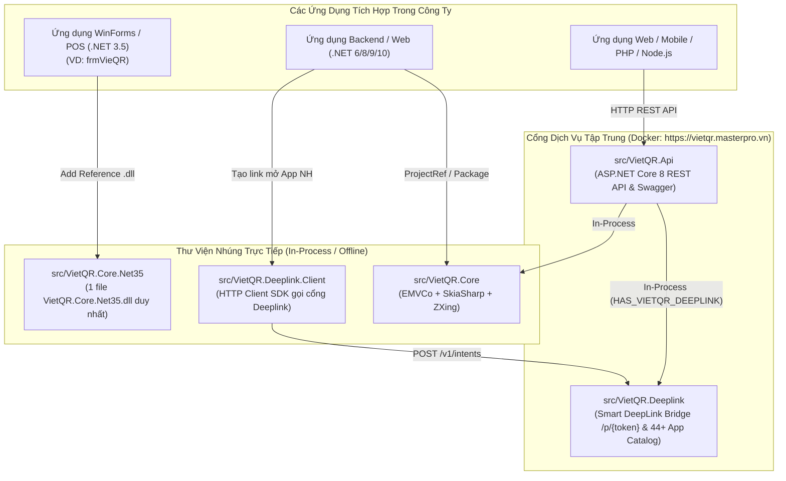

# Hệ Sinh Thái VietQR (NAPAS247 / EMVCo) — Tài Liệu Kỹ Thuật & Hướng Dẫn Tích Hợp Nội Bộ

<p align="center">
  
  &nbsp;&nbsp;&nbsp;&nbsp;&nbsp;&nbsp;&nbsp;&nbsp;
  
</p>

<p align="center">
  <b>Nền tảng xử lý mã thanh toán VietQR (NAPAS247 &amp; EMVCo) và điều hướng Deeplink 44+ ứng dụng ngân hàng</b><br>
  Hỗ trợ từ WinForms <b>.NET Framework 3.5</b> đến <b>.NET 6.0 / 8.0 / 9.0 / 10.0</b> &bull; Chạy 100% In-Process / Offline &bull; Tự chủ Gateway <code>https://vietqr.masterpro.vn</code>
</p>

---

## 1. Tổng Quan Kiến Trúc & Bản Đồ Dự Án (Solution Architecture)

Solution [`vietqr-core.sln`](vietqr-core.sln) bao gồm **5 projects** được phân tách rõ ràng theo từng môi trường tích hợp và vai trò vận hành:



### Bảng Chọn Nhanh Module Tích Hợp (Decision Matrix)

| Kịch bản dự án của bạn | Module cần dùng | Phương thức hoạt động | Tài liệu chi tiết |
| :--- | :--- | :--- | :--- |
| **Phần mềm WinForms / POS chạy `.NET Framework 3.5`** (thay thế `api.vietqr.io/v2/generate`) | **`VietQR.Core.Net35`** | Nhúng trực tiếp 1 file `VietQR.Core.Net35.dll` duy nhất (100% Offline, dùng `System.Drawing` GDI+, không cần Internet/RestSharp/Newtonsoft.Json). | [`src/VietQR.Core.Net35/README.md`](src/VietQR.Core.Net35/README.md) |
| **Backend / Dịch vụ `.NET 6.0 / 8.0 / 9.0 / 10.0`** cần tạo chuỗi EMVCo, vẽ ảnh PNG/WebP/SVG hoặc giải mã QR | **`VietQR.Core`** | Nhúng trực tiếp qua `ProjectReference`, `.dll` hoặc Internal NuGet (100% Offline, tốc độ ~1–5ms). | [`src/VietQR.Core/README.md`](src/VietQR.Core/README.md) |
| **Ứng dụng `.NET 6+`** cần lấy link Deeplink (`/p/{token}`) để khách bấm mở thẳng App Ngân hàng trên điện thoại | **`VietQR.Deeplink.Client`** | Gọi qua SDK C# (`IVietQrDeeplinkClient`) kết nối tới cổng `https://vietqr.masterpro.vn`. | [`src/VietQR.Deeplink.Client/README.md`](src/VietQR.Deeplink.Client/README.md) |
| **Ứng dụng đa ngôn ngữ (JS, Mobile, PHP, Python...)** hoặc cần gọi tạo QR / Deeplink qua HTTP API | **`VietQR.Api` + `VietQR.Deeplink`** | Gọi REST API tới cổng tập trung `https://vietqr.masterpro.vn` (đóng gói sẵn qua Docker). | Xem mục 2.3 & Mục 3 bên dưới & [`src/VietQR.Deeplink/README.md`](src/VietQR.Deeplink/README.md) |

---

## 2. Hướng Dẫn Tích Hợp Theo Từng Kịch Bản (Integration Guide)

### 2.1. Tích hợp cho dự án WinForms `.NET Framework 3.5` (`VietQR.Core.Net35`)

Thư viện `VietQR.Core.Net35` đóng gói toàn bộ 76+ ngân hàng, 76 logo, font chữ và bộ vẽ QR GDI+ vào **1 file `VietQR.Core.Net35.dll` duy nhất** (lấy tại `src/VietQR.Core.Net35/bin/Release/net35/VietQR.Core.Net35.dll`).

**Cách thay thế trực tiếp lời gọi `https://api.vietqr.io/v2/generate` trong Form `frmVieQR`:**

```csharp
using System;
using System.Drawing;
using System.Windows.Forms;
using VietQR.Core;

private void GenQR()
{
    try
    {
        string addInfo = !string.IsNullOrEmpty(_orderId) ? _orderId : _NDck;

        // Tạo trực tiếp đối tượng Image (Bitmap) Offline 100% (< 5ms)
        Image image = VietQrGenerator.GenerateImage(
            _bankName,      // Hỗ trợ cả mã BIN 6 số ("970422") hoặc mã/tên ngân hàng ("MB", "VCB", "CTG", "VIETCOMBANK"...)
            _bankAccount,   // Số tài khoản nhận
            _money,         // Số tiền kiểu decimal (<= 0 tự động tạo QR tĩnh)
            addInfo,        // Nội dung chuyển khoản (tối đa 95 byte)
            _FullName,      // Tên chủ tài khoản hiển thị trên ảnh thẻ
            "print"         // Mẫu thẻ: "print", "compact", hoặc "qr_only"
        );

        picQR.Image = image;
        picQR.SizeMode = PictureBoxSizeMode.Zoom;
        QRImage = image;
        btnDone.Enabled = true;
    }
    catch (Exception ex)
    {
        MessageBox.Show("Lỗi xử lý tạo mã QR: " + ex.Message);
    }
}
```
*(Nếu muốn giữ nguyên cấu trúc `VietQrApiRequest` / `VietQrApiResponse` có `data.qrDataURL` và `Base64ToImage`, xem chi tiết tại [`src/VietQR.Core.Net35/README.md`](src/VietQR.Core.Net35/README.md)).*

---

### 2.2. Tích hợp cho dự án `.NET 6.0 / 8.0 / 9.0 / 10.0` (`VietQR.Core` & `VietQR.Deeplink.Client`)

#### Bước 1: Đăng ký Dependency Injection trong `Program.cs`

```csharp
using VietQR.Core;
using VietQR.Deeplink.Client;

// 1. Đăng ký các dịch vụ lõi tạo & giải mã VietQR (IBankCatalog, IQrGenerator, QrImageService)
builder.Services.AddVietQrCore(options =>
{
    options.DefaultTemplate = "compact";
});

// 2. Đăng ký Client kết nối cổng Deeplink nội bộ của công ty
builder.Services.AddVietQrDeeplink(options =>
{
    options.BaseUrl = "https://vietqr.masterpro.vn";
    options.TimeoutSeconds = 10;
});
```

#### Bước 2: Sinh chuỗi EMVCo, Render ảnh thẻ & Tạo link mở App Ngân hàng

```csharp
using VietQR.Core;
using VietQR.Deeplink.Client;

public class PaymentService
{
    private readonly QrImageService _qrImageService;
    private readonly IVietQrDeeplinkClient _deeplinkClient;

    public PaymentService(QrImageService qrImageService, IVietQrDeeplinkClient deeplinkClient)
    {
        _qrImageService = qrImageService;
        _deeplinkClient = deeplinkClient;
    }

    public async Task CreateOrderQrAsync(CancellationToken ct)
    {
        // 1. Khởi tạo đối tượng VietQr (hỗ trợ cả mã BIN "970422", mã ngắn "MB", hoặc alias "MBBANK")
        var qr = new VietQr()
            .SetBeneficiaryOrganization("MB", "056789799999", VietQrServiceType.Account)
            .SetTransactionAmount("150000")
            .SetMerchantInfo("MASTERPRO VN")
            .SetAdditionalData(purpose: "THANH TOAN DH 1024");

        string emvPayload = qr.Build();

        // 2. Render ra mảng byte PNG / WebP / SVG (100% Offline)
        byte[] pngBytes = await _qrImageService.RenderBytesAsync(emvPayload, new QrRenderOptions
        {
            Template = "compact", // "compact", "print", hoặc "qr_only"
            Format = QrImageFormat.Png,
            BankBin = "970422",
            AccountNo = "056789799999",
            AccountName = "MASTERPRO VN",
            Amount = 150000,
            Description = "THANH TOAN DH 1024"
        }, ct);

        // 3. Tạo link rút gọn (/p/{token}) mở thẳng ứng dụng ngân hàng trên điện thoại
        DeeplinkIntentResult? intent = await qr.ToDeeplinkUrlAsync(_deeplinkClient, "MB", ct);
        // intent.Url => "https://vietqr.masterpro.vn/p/dQBA9ZYE" (Hiệu lực 300 giây)
    }
}
```

---

### 2.3. Tích hợp qua HTTP REST API (`https://vietqr.masterpro.vn`)

Dành cho Frontend, Mobile App hoặc các hệ thống không viết bằng .NET:

| Chức năng | Phương thức & Endpoint | Mô tả & Tham số chính |
| :--- | :--- | :--- |
| **Tạo mã QR & Ảnh Base64 (GET)** | `GET /api/v1/vietqr-core/generate` | `?bankBin=970422&accountNo=056789799999&amount=150000&description=DH1024&accountName=MASTERPRO&template=compact&format=png` |
| **Tạo mã QR & Ảnh Base64 (POST)** | `POST /api/v1/vietqr-core/generate` | Body JSON: `{"bankBin":"970422","accountNo":"056789799999","amount":"150000","description":"DH1024","template":"print"}` |
| **Lấy trực tiếp luồng ảnh (``)** | `GET /api/v1/vietqr-core/image` | Trả trực tiếp binary `image/png`, `image/webp` hoặc `image/svg+xml` để nhúng thẳng vào thẻ ``. |
| **Giải mã chuỗi EMVCo (Parse)** | `POST /api/v1/vietqr-core/parse` | Body JSON: `{"qrCode":"000201..."}` $\rightarrow$ Kiểm tra CRC16 và bóc tách các trường TLV. |
| **Đọc mã QR từ file ảnh (Decode)** | `POST /api/v1/vietqr-core/decode` | Hỗ trợ `multipart/form-data` (upload file ảnh) hoặc JSON Base64. |
| **Danh mục 76+ Ngân hàng NAPAS** | `GET /api/v1/vietqr-core/banks` | Trả về toàn bộ 76+ ngân hàng (hoặc tra cứu `/api/v1/vietqr-core/banks/{binOrCode}`). |
| **Danh sách 44+ App hỗ trợ Deeplink** | `GET /api/v1/vietqr-core/deeplink/apps` | Trả về danh sách 44+ ứng dụng ngân hàng/ví kèm cờ `supportsAutofill` và đường dẫn icon `/icons/{appCode}.png`. |
| **Tạo link Deeplink mở App** | `POST /api/v1/vietqr-core/deeplink/intents` | Body JSON: `{"appCode":"MB","qrCode":"000201..."}` $\rightarrow$ Trả về `{"url":"https://vietqr.masterpro.vn/p/{token}","expiresInSeconds":300}`. |

---

## 3. Hướng Dẫn Triển Khai Production Qua Docker (`https://vietqr.masterpro.vn`)

File [`src/VietQR.Api/Dockerfile`](src/VietQR.Api/Dockerfile) đóng gói cả `VietQR.Core`, `VietQR.Deeplink.Client`, `VietQR.Deeplink` và `VietQR.Api` vào **1 Docker Image duy nhất** (tự động kích hoạt cờ `HAS_VIETQR_DEEPLINK` để xử lý Deeplink In-Process).

### Bước 1: Khởi chạy bằng `docker-compose.yml`

Tạo file `docker-compose.yml` tại thư mục gốc của repo trên máy chủ:

```yaml
services:
  vietqr-api:
    build:
      context: .
      dockerfile: src/VietQR.Api/Dockerfile
    image: masterpro/vietqr-server:latest
    container_name: vietqr-server
    restart: unless-stopped
    ports:
      - "8080:8080"
    environment:
      - ASPNETCORE_ENVIRONMENT=Production
      - ASPNETCORE_URLS=http://+:8080
      - Deeplink__BaseUrl=https://vietqr.masterpro.vn
      - Deeplink__IntentTtlSeconds=300
      - Deeplink__MaxActiveIntents=50000
      - Deeplink__TokenSecret=Thay_Bang_Chuoi_Bi_Mat_Ngau_Nhien_32_Ky_Tu
    healthcheck:
      test: ["CMD", "curl", "-f", "http://localhost:8080/health/live"]
      interval: 30s
      timeout: 5s
      retries: 3
```

Chạy lệnh build và khởi động:
```bash
docker compose up -d --build
```

### Bước 2: Cấu hình Nginx Reverse Proxy (Bắt buộc truyền `X-Forwarded-Host` & `X-Forwarded-Proto`)

```nginx
server {
    listen 443 ssl http2;
    server_name vietqr.masterpro.vn;

    ssl_certificate     /etc/ssl/masterpro/fullchain.pem;
    ssl_certificate_key /etc/ssl/masterpro/privkey.pem;

    location / {
        proxy_pass         http://127.0.0.1:8080;
        proxy_http_version 1.1;
        proxy_set_header   Host              $host;
        proxy_set_header   X-Real-IP         $remote_addr;
        proxy_set_header   X-Forwarded-For   $proxy_add_x_forwarded_for;
        proxy_set_header   X-Forwarded-Proto $scheme;
        proxy_set_header   X-Forwarded-Host  $host;
    }
}
```

---

## 4. Hướng Dẫn Dành Cho Dev Phát Triển Mở Rộng (Developer Guide)

### 4.1. Quy trình Build & Xuất file `.dll` trên máy Local

Yêu cầu cài đặt **.NET 8.0 SDK** (hoặc .NET 9.0 / 10.0 SDK). Không cần cài thêm bộ SDK `.NET 3.5` cũ vì `VietQR.Core.Net35.csproj` đã tự động trỏ tới Reference Assemblies chuẩn của Windows (`C:\Windows\Microsoft.NET\Framework\v2.0.50727` và `v3.5`).

```bash
# 1. Khôi phục package và build toàn bộ 5 projects ở chế độ Release
dotnet restore vietqr-core.sln
dotnet build vietqr-core.sln -c Release --no-restore

# 2. Vị trí các file .dll đầu ra sau khi build:
# - Bản .NET 3.5 (WinForms): src/VietQR.Core.Net35/bin/Release/net35/VietQR.Core.Net35.dll
# - Bản .NET 6/8/9 (Core):   src/VietQR.Core/bin/Release/net8.0/VietQR.Core.dll
# - Bản Deeplink Client:     src/VietQR.Deeplink.Client/bin/Release/net8.0/VietQR.Deeplink.Client.dll
```

> ⚠️ **Lưu ý khi sửa code trong `VietQR.Core.Net35`:**
> Để các dự án WinForms cũ mở bằng **Visual Studio 2008 (C# 3.0)** hoặc gọi qua PowerShell không bị lỗi thiếu hàm, khi thêm hàm mới có tham số mặc định (optional parameters), **luôn viết thêm các hàm nạp chồng tường minh (explicit method overloads)** và giữ constructor không tham số `public QrImageService()`.

---

### 4.2. Quy trình thêm Ngân hàng hoặc Ví điện tử mới

Khi NAPAS bổ sung ngân hàng thành viên mới hoặc cần thêm ứng dụng vào cổng Deeplink, thực hiện theo **3 bước** sau:

1. **Cập nhật danh mục ngân hàng & Logo cho bộ tạo ảnh QR (`VietQR.Core` & `VietQR.Core.Net35`):**
   - Thêm thông tin ngân hàng (`bin`, `code`, `shortName`, `name`, `logo`) vào [`src/VietQR.Core/Resources/banks.json`](src/VietQR.Core/Resources/banks.json).
   - Đặt file ảnh logo PNG nền trong suốt có tên `{BIN_6_SO}.png` (ví dụ: `970499.png`) vào thư mục [`src/VietQR.Core/Resources/Logos/`](src/VietQR.Core/Resources/Logos/).
   - *(Cả `VietQR.Core` và `VietQR.Core.Net35` đều nhúng tự động `Resources\banks.json` và `Resources\Logos\*.png` làm `EmbeddedResource` khi biên dịch).*
2. **Bổ sung Bí danh (`Aliases`) nếu ngân hàng có nhiều tên gọi:**
   - Thêm cặp `{ "BIN", "TEN_BI_DANH" }` vào hàm `RegisterCommonAliases()` trong [`src/VietQR.Core/Banks/EmbeddedBankCatalog.cs`](src/VietQR.Core/Banks/EmbeddedBankCatalog.cs) và [`src/VietQR.Core.Net35/Banks/BanksAndCatalog.cs`](src/VietQR.Core.Net35/Banks/BanksAndCatalog.cs).
3. **Thêm cấu hình mở App di động vào `VietQR.Deeplink`:**
   - Mở [`src/VietQR.Deeplink/Catalog/DeeplinkAppCatalog.cs`](src/VietQR.Deeplink/Catalog/DeeplinkAppCatalog.cs), thêm phần tử `DeeplinkAppDefinition` mới (khai báo `AppCode`, `Bin`, `ShortName`, `AppName`, `SupportsAutofill`, `AutofillAppId`, `CustomScheme`, `AndroidPackage`, `IosAppStoreId`).
   - Đặt file icon vuông `128x128` tên chữ thường `{appcode}.png` vào thư mục [`src/VietQR.Deeplink/wwwroot/icons/`](src/VietQR.Deeplink/wwwroot/icons/).

---

### 4.3. Các Quy Tắc Nghiệp Vụ Bất Biến (NAPAS247 / EMVCo Domain Invariants)

Khi chỉnh sửa các lớp trong thư mục `Emv/` hoặc `Parsing/`, bắt buộc tuân thủ 4 quy tắc cốt lõi sau để đảm bảo 100% ứng dụng ngân hàng tại Việt Nam quét được mã:

1. **Đo độ dài TLV bằng số byte UTF-8 (`Encoding.UTF8.GetByteCount`):**
   - Chuẩn ISO/IEC 7816 và EMVCo quy định trường `Length` (2 chữ số `"00"`..`"99"`) trong cấu trúc `Tag-Length-Value` là **số byte octet UTF-8**, tuyệt đối không dùng `.Length` (UTF-16) khi đóng gói hoặc bóc tách TLV.
2. **Phân biệt rõ Dịch vụ Chuyển khoản Tài khoản (`QRIBFTTA`) và Thẻ (`QRIBFTTC`):**
   - `VietQrServiceType.Account` sinh mã định danh `0208QRIBFTTA` và hiển thị nhãn **`"Số TK"`** / **`"Số tài khoản"`**.
   - `VietQrServiceType.Card` sinh mã định danh `0208QRIBFTTC` và hiển thị nhãn **`"Số thẻ"`**.
   - Không tự ý đoán loại dịch vụ dựa trên độ dài chuỗi số tài khoản/số thẻ (vì tài khoản ảo Virtual Account cũng có thể dài 16–19 ký tự).
3. **Phương thức khởi tạo QR Tĩnh (`010211`) vs. QR Động (`010212`):**
   - Khi có truyền số tiền (`Tag 54 > 0`), số hóa đơn (`Tag 62.01`) hoặc mã đơn hàng (`Tag 62.05`), trường `Tag 01` tự động chuyển sang **`"12"` (QR Động)** trừ khi dev gọi tường minh `.SetPointOfInitiationMethod(VietQrType.Static)`.
4. **Checksum CRC16-CCITT (`Tag 63`):**
   - Luôn nằm ở cuối chuỗi EMVCo (`6304` + 4 ký tự Hex in hoa), sử dụng đa thức `0x1021` và giá trị khởi tạo `0xFFFF` theo đúng Mục 5.2.15 của [Tài liệu đặc tả kỹ thuật NAPAS v1.0](docs/QR_Format_T%26C_v1.0_VN_092021.pdf).

---

## 5. Tài Liệu Tham Chiếu Chi Tiết Từng Module

- 📘 **[Tài liệu `VietQR.Core` (.NET 6/8/9/10)](src/VietQR.Core/README.md)** — Chi tiết API sinh chuỗi EMVCo, SkiaSharp rendering, SVG & ZXing Decoder.
- 📗 **[Tài liệu `VietQR.Core.Net35` (WinForms .NET 3.5)](src/VietQR.Core.Net35/README.md)** — Hướng dẫn tích hợp `.dll` cho WinForms `.NET 3.5` và thay thế `api.vietqr.io/v2/generate`.
- 📙 **[Tài liệu `VietQR.Deeplink` (Server Engine)](src/VietQR.Deeplink/README.md)** — Kiến trúc Smart Payment Bridge `/p/{token}`, Intent Store & danh mục 44+ ứng dụng.
- 📕 **[Tài liệu `VietQR.Deeplink.Client` (Client SDK)](src/VietQR.Deeplink.Client/README.md)** — Hướng dẫn cấu hình và gọi API tạo link mở ứng dụng ngân hàng.
- 📒 **[Quy chuẩn đóng góp & Coding Standards (`CONTRIBUTING.md`)](CONTRIBUTING.md)** — Quy tắc viết code, tối ưu bộ nhớ và quy ước Conventional Commits.
